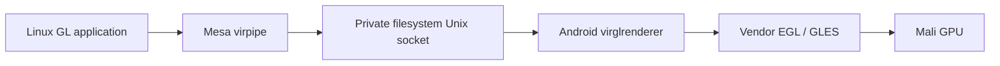

# ADR-0081: Android GLES renderer for guest Mesa

Status: accepted for the requested best-effort experiment, 2026-10-27.

## Context

Android hardware-accelerated presentation does not accelerate guest drawing.
The S7 Edge's Mali-T880 has usable Android GLES APIs, but no guest DRM driver.
The user requested implementing the Mesa/virgl route and testing it on ADB.
The existing guest already supplies Ubuntu Mesa and explicitly installed GUI
packages; this does not introduce a general package installer.

## Decision

Build virglrenderer 1.3.0 and libepoxy 1.5.10 from digest-pinned MIT sources
with NDK 29.0.14206865. Use public Android EGL/GLES and shared-memory APIs.
Do not require Vulkan, ANGLE on the host, DRM nodes, root, another guest, or
another X display. Both native dependencies' license texts ship in the APK.

The X11 service starts the renderer executable from the installer's read-only
`nativeLibraryDir`, packaged as `libvirglserver.so`. This extends the documented
native execution exception with a source-built artifact; no generated binary
is committed or executed from writable app storage. The child uses
`PR_SET_PDEATHSIG`, checks the parent-death race, and runs without forking.
Normal X11 shutdown terminates/reaps it before removing the socket. A failed
GPU child does not kill X11.

The socket is `/tmp/.virgl` in the existing guest, inside app-private storage.
Its full Android pathname must fit the 107-byte Unix pathname limit. There
is no TCP graphics listener. Filesystem app-UID access supplies the boundary.

Each launcher app checks guest EGL offscreen draw/readback under a bounded
8-second probe before selecting `GALLIUM_DRIVER=virpipe`. Missing libraries,
dead server, invalid pixels, or failed initialization retain llvmpipe. Logs
are `/tmp/nusadesk-graphics.log` and `/tmp/nusadesk-virgl.log`. A live PID or
existing socket alone is not readiness. Openbox stays on software rendering.
`LIBGL_ALWAYS_SOFTWARE=1` directs Mesa's software-loader path to the explicitly
selected Gallium driver; with `virpipe` that driver forwards to Android.

Electron 44 needs an explicit compatibility launcher:
`/opt/lw-desktop/gpu-electron.sh <existing Electron launcher> [arguments]`.
It probes the route, then applies Mesa 3.3 compatibility / GLES 3.0 / GLSL 330
version overrides and Electron's ANGLE GLES + ignore-blocklist options. These
overrides expose a working subset; they do not establish full API conformance.
They apply only to this explicit launch, and are cleared on software fallback.
Generic Linux entries are not identified heuristically as Electron apps.
On the test phone, the existing NusaShell desktop entry uses this wrapper;
its original entry is retained as `.desktop.pre-virgl`.

Mali-T880's GLES vtest path fails the default multisample WebGL framebuffer
and can lose the client context. Non-MSAA WebGL shader readback passed.
Limiting advertised samples prevented Electron's GLES3 initialization, and
rounding sample counts did not fix the framebuffer. Both attempted native
workarounds were reverted. MSAA remains unsupported in this experiment;
applications requiring it may need software rendering. This is a known limit,
not a completed driver fix.

Sustained scroll cost was measured on the same conversation and app with only
the Gallium driver differing: the virgl arm held a 16.7 ms median frame
interval against llvmpipe's 134–184 ms, and its p95 was 134–150 ms against
367–401 ms. The software p95 matches the user's reported 300–500 ms delay. The
virgl arm is not smooth yet — about a third of its frames still exceeded 50 ms
during input — so this narrows the reported problem rather than resolving
scrolling.

## Verification and limits

EGL pixels, visible GLX gears, Electron GPU status, WebGL shader pixels and the scroll comparison are distinct checks.
`glxinfo -B` has an X_GetImage BadMatch here and is not the readiness check.
This is not zero-copy presentation, a general GPU driver, video acceleration,
or full GL/ES conformance. The measured scroll result is a frame-interval
comparison in one Electron view, not a general application-latency claim.
API 29 arm64 on this custom-ROM S7 is the tested configuration; other devices
and 16 KB runtime behavior remain untested.
